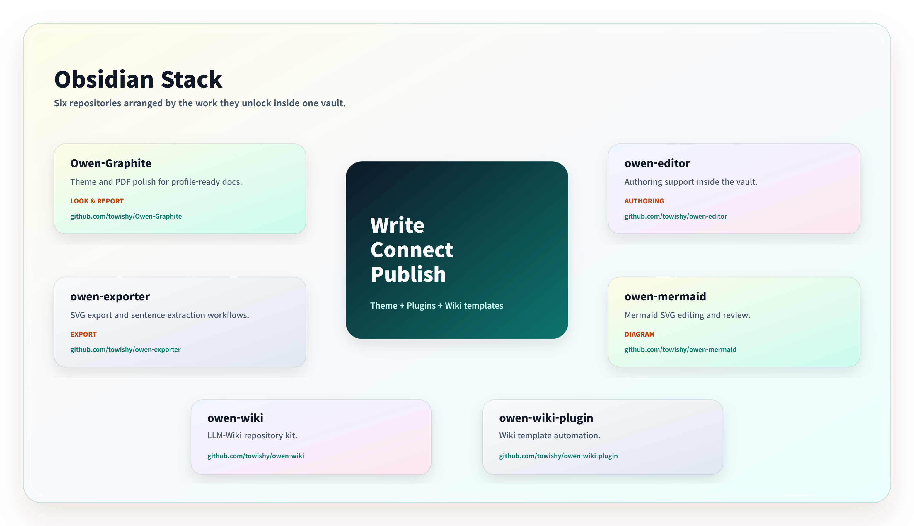
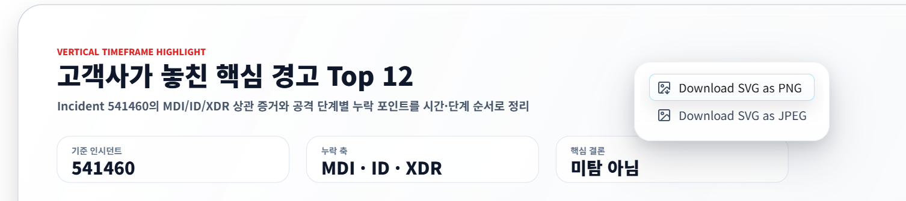
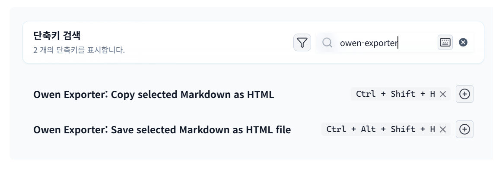
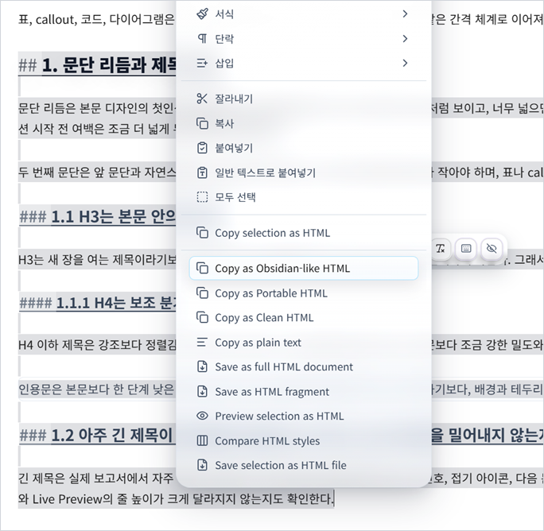
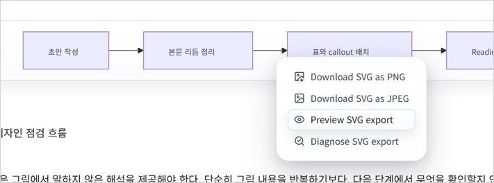
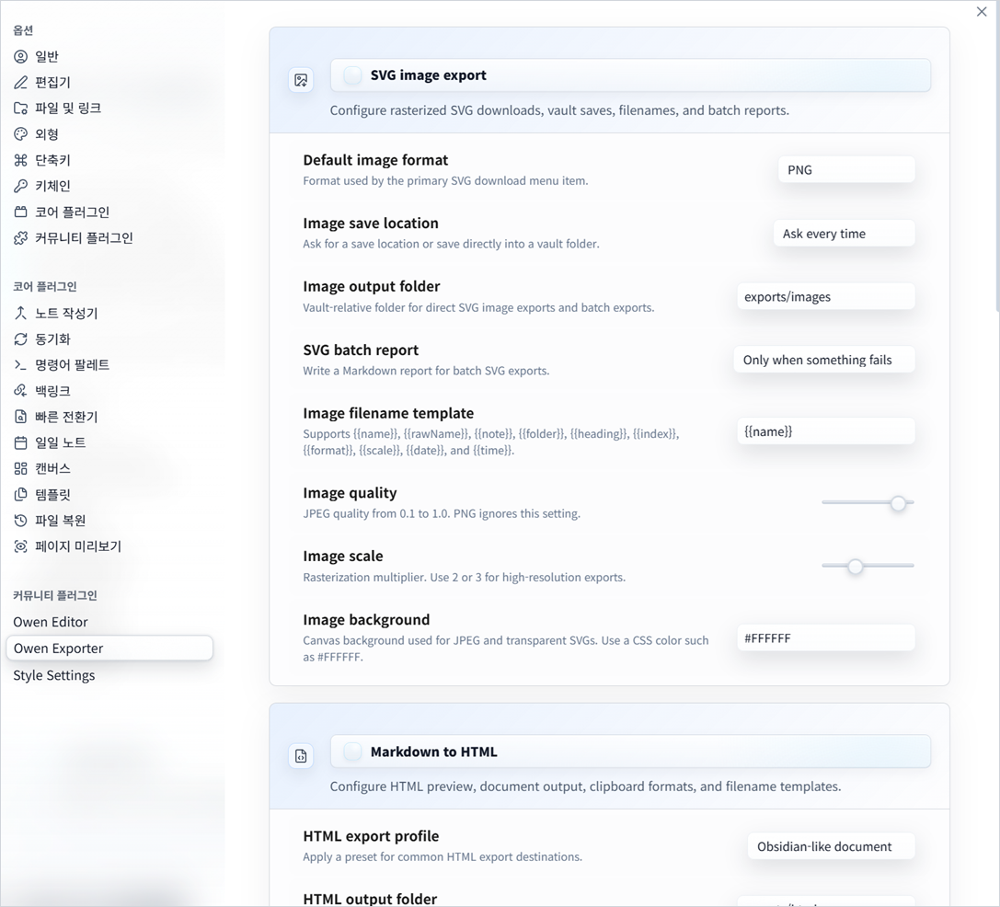
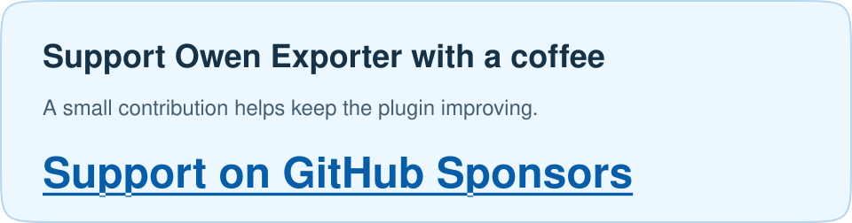

[](https://github.com/towishy/owen-exporter/releases/latest)
[](LICENSE)
[](https://obsidian.md)
[](#features)

<br>
<br>
<br>



<br>

## The Owen stack

Pick the tool for the part of the workflow you want to improve. These projects work together, but you do not need to install everything.

| Project | Its role in your workflow |
| --- | --- |
| [Owen Graphite](https://github.com/towishy/Owen-Graphite) | Theme, typography, workspace styling, and PDF polish. |
| [Owen Editor](https://github.com/towishy/owen-editor) | Markdown authoring, editing commands, tables, and report helpers. |
| **[Owen Exporter](https://github.com/towishy/owen-exporter)** | SVG-to-image export and Markdown/HTML handoff workflows. |
| [Owen Mermaid](https://github.com/towishy/owen-mermaid) | Mermaid viewing, visual editing, and image export. |
| [Owen Wiki](https://github.com/towishy/owen-wiki) | A repository template for LLM-assisted knowledge operations. |

<br>

# Owen Exporter

**Turn SVG embeds and Markdown notes into portable images and HTML.**

Export embedded SVG images as PNG/JPEG, or copy and save selected Markdown and notes as HTML without leaving Obsidian.

**Desktop Obsidian plugin · SVG rasterization · HTML profiles · Batch export**

[Quick start](#quick-start) · [Features](#features) · [Preview](#preview) · [Documentation](#documentation)

<br>

## Preview




<details>
<summary>Submenus and settings</summary>





</details>

<br>

## Features

| For your workflow | What Owen Exporter brings |
| --- | --- |
| Export images | PNG/JPEG output for SVG embeds, configured scale, JPEG quality, background, filenames, and vault-folder or save-dialog destinations. |
| Review before saving | SVG diagnostics and previews with source/output sizes, filenames, external-reference warnings, and export actions. |
| Copy rich content | HTML plus plain text, HTML only, or plain text only; shortcuts for Obsidian-like, Portable, Clean HTML, and plain-text output. |
| Save HTML | Selected Markdown, rendered reading-mode selections, or a whole note as a full document or fragment. |
| Reuse profiles | Built-in/custom profiles for folders, filename/title templates, style, save mode, clipboard format, and quality options. |
| Handle assets | Preserve paths, rewrite relative paths, copy local images to an asset folder, or inline images as base64 data URLs. |
| Export batches | All SVG embeds, folder notes, or linked notes; progress queues, optional reports/manifests, and changed-only HTML exports. |
| Validate output | Reports for broken internal links, missing/external images, frontmatter handling, and SVG warnings; side-by-side HTML-style previews. |
| Continue the workflow | Recent exports, export history, open/reveal/copy-path actions, post-export automation, optional inserted image links, and settings JSON import/export. |

<details>
<summary>Filename tokens, HTML quality, and per-note overrides</summary>

SVG filename tokens include `{{name}}`, `{{note}}`, `{{folder}}`, `{{index}}`, `{{format}}`, `{{scale}}`, `{{date}}`, and `{{time}}`.

HTML quality options include frontmatter exclusion, heading IDs, callout classes, and internal-link conversion to Obsidian URIs. Tables, code blocks, and callouts can carry inline styles from the active Obsidian preview.

Custom full-document templates support `{{title}}`, `{{content}}`, `{{sourcePath}}`, `{{style}}`, `{{date}}`, and `{{time}}`.

Per-note frontmatter under `owen-export` can override `profile`, `filename`, `style`, `saveMode`, `title`, and `assetMode`.

Batch HTML exports can write `export-manifest.json`; changed-only actions use the last manifest to skip unchanged notes.

</details>

<br>

## Quick start

1. Open the [latest release](https://github.com/towishy/owen-exporter/releases/latest).
2. Download **`main.js`**, **`manifest.json`**, and **`styles.css`** from **Assets**, not GitHub's generated source archive.
3. Place them directly inside `<YourVault>/.obsidian/plugins/owen-exporter/`.
4. Reload Obsidian and enable **Owen Exporter** under **Community plugins**.
5. Configure image and HTML destinations before exporting.

<br>

## Everyday workflow

1. **Export an image.** In Reading view, right-click an embedded SVG and choose the default or alternate image format.
2. **Copy or save HTML.** Select Markdown in Source mode and use the context menu, or select rendered text in Reading view.
3. **Choose the handoff style.** Compare Obsidian-like, Portable, and Clean HTML, then select the appropriate profile.
4. **Scale up safely.** Use batch commands, inspect reports/manifests, and validate assets before sharing.
5. **Revisit output.** Repeat the last export or use export history to open, reveal, or copy a saved file's path.

Default hotkeys:

- **Ctrl/Cmd + Shift + H:** copy selected Markdown as HTML.
- **Ctrl/Cmd + Shift + Alt + H:** save selected Markdown as an HTML file.

Use **Export all SVG embeds in current note** for image batches and **Diagnose SVG embeds in current note** before troubleshooting image output.

<br>

## Compatibility and boundaries

- Requires **desktop Obsidian 1.5.0 or later**; the manifest marks the plugin desktop-only.
- The interface follows Obsidian: Korean locales use Korean; other locales use English. Override this under **Settings → Owen Exporter → Interface → Language**.
- A local save dialog can target a PC folder; when unavailable, the plugin falls back to browser download. Direct-vault saving uses the configured output folder instead.
- Reading-mode text selections export the selected rendered HTML fragment, not a reconstruction of the original Markdown source.
- Choose style and asset modes deliberately: output fidelity, portability, and file size have different trade-offs.
- Exporter handles image/HTML delivery; it is not a replacement for Obsidian's PDF export or Mermaid's visual editor.

<br>

## Documentation

| Start here | What you will find |
| --- | --- |
| [Latest release](https://github.com/towishy/owen-exporter/releases/latest) | Built plugin files. |
| [Plugin manifest](manifest.json) | Plugin ID and supported host version. |
| [Package scripts](package.json) | Development, tests, build, and release entry points. |
| [Issue tracker](https://github.com/towishy/owen-exporter/issues) | Export problems and feature requests. |

<br>

## Contributing and license

```bash
npm install
npm run test
npm run build
```

For local testing, copy or symlink the built plugin files into a vault's `.obsidian/plugins/owen-exporter/` folder.

After a clean committed release build, `npm run release -- "Release notes"` validates the worktree, builds, tags the package version, pushes `main` and the tag, and publishes the plugin assets. Do not use it for ordinary documentation changes.

Include output format, style/profile, platform, and reproduction steps when [reporting a problem](https://github.com/towishy/owen-exporter/issues). Remove private note contents and embedded customer assets.

**License:** MIT — see [LICENSE](LICENSE).

---

<br>

## Support

<p align="center">
  <a href="https://mdbox.sarang.day/">
    
  </a>
</p>

<br>

<p align="center">
  <a href="https://github.com/sponsors/towishy">
    
  </a>
</p>

Owen Exporter is free and open source. If it helps your image export or HTML handoff workflow, you can support maintenance through [GitHub Sponsors](https://github.com/sponsors/towishy).
